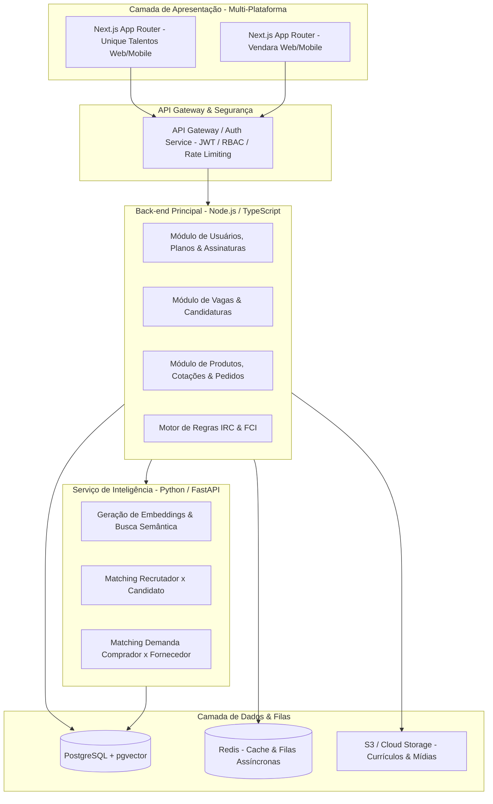

# Proposta Técnica & Arquitetural
**Desenvolvimento das Plataformas Unique Talentos & Vendara**
*Cliente: Grupo Unique | Versão: 1.0*

---

## 1. Carta de Apresentação e Alinhamento Estratégico

Prezada equipe do Grupo Unique,

Apresento esta proposta técnica e de arquitetura em resposta ao briefing para o desenvolvimento do **Portal de Empregos (Unique Talentos)** e do **Marketplace B2B (Vendara)**. 

Entendemos que o desafio central reside em unir **simplicidade na experiência do usuário (UX)** com um **mecanismo robusto de inteligência e matching**, garantindo:
1. Conexão assertiva entre candidatos e recrutadores (Unique Talentos);
2. Geração qualificada de negócios B2B e mensuração ativa de demanda através do **IRC (Índice de Interesse Real de Compra)** e **FCI (Fluxo Comercial Inverso)** (Vendara);
3. Uma base tecnológica única, modular, segura (LGPD) e com alta capacidade de escala.

Abaixo apresento a arquitetura recomendada, o plano de entrega faseado (com foco em MVP ágil), os modelos de contratação e os detalhes da demonstração prática do meu trabalho.

---

## 2. Arquitetura e Decisões Tecnológicas

Para atender a ambas as plataformas sem duplicar esforços de infraestrutura, recomendamos uma abordagem **Monorepo Modular** com separação clara de responsabilidades:



### 2.1 Justificativa das Tecnologias Selecionadas

| Camada | Tecnologia | Motivo da Escolha & Vantagens Técnicas |
| :--- | :--- | :--- |
| **Front-end** | **React / Next.js (TypeScript)** | Renderização híbrida (SSR para SEO de vagas e produtos, SPA para dashboards internos rápidos). Responsividade mobile-first nativa com TailwindCSS e suporte a PWA (permite instalação como app no celular sem custo inicial de desenvolvimento nativo). |
| **Back-end Core** | **Node.js (NestJS ou Fastify)** | Altíssimo throughput para operações I/O (APIs REST, Webhooks de pagamentos e notificações). Tipagem forte fim-a-fim compartilhada com o frontend. |
| **Serviço de IA & Matching** | **Python (FastAPI)** | Padrão da indústria para processamento de linguagem natural (NLP), processamento de currículos (PDF/DOCX), integração com modelos de LLM (OpenAI, Gemini ou modelos open-source) e geração de embeddings. |
| **Banco de Dados Relacional & Vetorial** | **PostgreSQL + extensão `pgvector`** | Elimina a necessidade e o custo de manter bancos vetoriais dedicados (como Pinecone). Permite que consultas transacionais (filtros por salário, cidade, categoria) e busca semântica por IA rodem na mesma consulta SQL com alta performance. |
| **Filas & Mensageria** | **Redis + BullMQ** | Envio assíncrono de e-mails/WhatsApp, recomputação em segundo plano de métricas analíticas (IRC/FCI) e processamento em lote de candidaturas. |
| **Storage & Arquivos** | **AWS S3 ou Cloudflare R2** | Armazenamento seguro de anexos, currículos e imagens de produtos com URLs pré-assinadas temporárias (atendendo à LGPD). |

---

## 3. Conformidade com LGPD e Segurança

Como ambas as plataformas tratam dados sensíveis (currículos profissionais, pretensões salariais e dados comerciais sigilosos), a arquitetura incorpora:
- **Controle de Acesso Granular (RBAC)**: Separação estrita de permissões entre Administrador, Empresa/Recrutador, Candidato, Comprador e Fornecedor.
- **Isolamento de Dados (Multi-tenancy seguro)**: Validação em nível de repositório de dados para evitar vazamento entre empresas.
- **Anonimização & Consentimento**: Gestão de termos de privacidade na inscrição, logs de consentimento e capacidade de exclusão/anonimização a pedido do titular (direito LGPD).
- **Criptografia**: TLS 1.3 em trânsito e AES-256 em repouso no banco de dados e arquivos de mídia.

---

## 4. Estratégia de Implementação e Escopo do MVP

Em estrita consonância com a diretriz do briefing, **a meta do MVP é entregar valor e validação de negócio imediata**, sem complexidade desnecessária.

```
Cronograma Estimado de Entrega (10 a 12 semanas para o MVP completo)

[Fase 1: Fundação & Auth] ──> [Fase 2: Portais & Buscas] ──> [Fase 3: Matching & Métricas] ──> [Fase 4: Monetização & Testes]
       (Semanas 1-3)                  (Semanas 4-6)                    (Semanas 7-9)                   (Semanas 10-12)
```

### Detalhamento das Fases

#### Fase 1: Fundação, Autenticação e Modelagem (Semanas 1 a 3)
- Configuração de ambiente de nuvem, banco de dados e pipeline de CI/CD.
- Sistema de autenticação seguro (Login com e-mail/senha, Google, recuperação de senha).
- Gestão de perfis unificados com regras de papel (Empresa vs Candidato vs Comprador vs Fornecedor).

#### Fase 2: Módulos Operacionais Centrais (Semanas 4 a 6)
- **Unique Talentos**: Publicação de vagas com formulário guiado, upload/parsing de currículos e painel de candidaturas.
- **Vendara**: Cadastro de catálogo de produtos/serviços e registro de demandas de compras.
- Motor de busca em tempo real com filtros facetados (localização, faixa salarial, segmento, categoria).

#### Fase 3: Conexões Inteligentes & Métricas B2B (Semanas 7 a 9)
- Implementação da busca semântica integrada com IA (busca por intenção).
- Painel de acompanhamento do **IRC (Índice de Interesse Real de Compra)** e **FCI (Fluxo Comercial Inverso)**.
- Notificações ativas no sistema e por e-mail para novas oportunidades e candidaturas.

#### Fase 4: Monetização, Testes Finais e Go-Live (Semanas 10 a 12)
- Integração de Gateway de Pagamento (Stripe, Pagar.me ou Asaas) para gestão de planos/assinaturas.
- Testes automatizados (Unitários e E2E), auditoria de segurança e otimização para dispositivos móveis.
- Lançamento em ambiente de produção (Beta fechado / Go-Live).

---

## 5. Modelos de Contratação e Estimativa Financeira

Oferecemos flexibilidade de contratação para melhor se adequar ao fluxo orçamentário do Grupo Unique:

### Opção A: Projeto Fechado por Fases (Recomendado para escopos bem delimitados)
- **Remuneração vinculada a marcos de entrega (milestones)** mediante aprovação em homologação.
- **Garantia técnica pós-entrega**: 60 dias de suporte e correção de bugs sem custo adicional.
- *Estimativa de Investimento*: R$ `[INSERIR VALOR ESTIMADO DO PROJETO]` parcelado pelas 4 fases do cronograma.

### Opção B: Alocação Dedicada / Sprint Mensal (Squad / Full Stack Lead)
- Foco em desenvolvimento contínuo, iterações rápidas com o time de produto e priorização dinâmica.
- Contrato mensal com valor fixo por ciclo de 4 semanas.
- *Estimativa de Investimento*: R$ `[INSERIR VALOR/MÊS]` por ciclo quinzenal/mensal de desenvolvimento.

---

## 6. Demonstração Prática e Portfólio

Para validação prática dos critérios exigidos no item 6 do briefing técnico:

### 6.1 Links de Demonstração e Acesso para Testes
- **Plataforma / Portal de Demonstração (Vercel)**: [https://desafio-psi-ashy.vercel.app](https://desafio-psi-ashy.vercel.app)
- **Repositório do Código Fonte (GitHub)**: [https://github.com/Lohran39/desafio-unique-vendara](https://github.com/Lohran39/desafio-unique-vendara)
- **Acesso Rápido para Testes (DemoBar Fixa)**:
  - *Perfil Recrutadora (Unique Talentos)*: Ana Beatriz | InovaTech Solutions
  - *Perfil Candidato Dev Sênior (Unique Talentos)*: Lucas Moreira | Full Stack Sênior
  - *Perfil Comprador B2B (Vendara)*: Roberto Camargo | Metalúrgica Alfa
  - *Perfil Fornecedora B2B (Vendara)*: Juliana Prado | Nexus Máquinas Industrial
  - *Perfil Administrador Master*: Diretoria Grupo Unique
  *(Não requer login ou cadastro prévio: basta clicar no papel desejado na barra de demonstração superior)*

### 6.2 O Que Pode Ser Testado no Ambiente
1. **Cadastro e Onboarding**: Fluxo completo de criação de conta com validação de dados.
2. **Busca e Filtros Instantâneos**: Teste de filtros combinados com atualização rápida sem recarregar a tela.
3. **Publicação e Gerenciamento**: Criação de vagas/itens de catálogo e visualização imediata no feed.
4. **Painel de Controle (Dashboard)**: Métricas em tempo real e gestão de conexões/candidaturas.
5. **Experiência Mobile**: Navegação 100% fluida em smartphones (iOS e Android).

### 6.3 Resumo de Responsabilidades no Projeto Demonstrado
- **Arquitetura & Engenharia Full Stack**: Desenvolvido diretamente por mim utilizando `[React/Next.js, Node.js/PostgreSQL/Python]`.
- **Destaques de Implementação**: Modelagem do banco de dados relacional, arquitetura multi-tenant, integração de APIs de pagamento e otimização de latência de consultas complexas.

---

## 7. Próximos Passos

Estamos prontos para:
1. Disponibilizar os acessos e realizar uma **sessão de demonstração técnica guiada** (15 a 30 minutos);
2. Analisar os ativos ou repositórios já existentes no Grupo Unique para diagnosticar o que pode ser reaproveitado;
3. Refinar o cronograma e iniciar o planejamento da Sprint 1 do MVP.

**Contato:**
- **Nome:** `[SEU NOME COMPLETO]`
- **E-mail:** `[SEU EMAIL]`
- **Telefone / WhatsApp:** `[SEU TELEFONE]`
- **LinkedIn / GitHub:** `[SEU LINKEDIN / GITHUB]`
